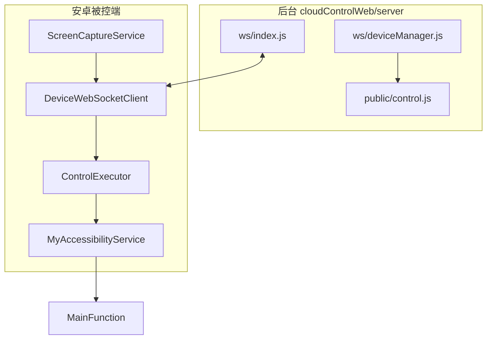

# 技术架构与接口协议

被控端 ↔ Node 后台 ↔ Web 控制台。优化项见 [OPTIMIZATION.md](./OPTIMIZATION.md)。

---

## 1. 架构概览



---

## 2. WebSocket 连接

```
ws(s)://<host>:<port>/ws?clientType=device&token=<DEVICE_TOKEN>&username=<账号>
```

- `username` 必须与注册消息 `owner`、后台用户一致。
- 连接成功后发送 `register`，随后周期 `ping`（**10s**）。

---

## 3. 画面传输（设备 → 服务端）

### 3.1 二进制帧（推荐）

与 `server/ws/frameProtocol.js` 一致：

```
[0xF1][format:1][deviceIdLen:2 BE][deviceId UTF-8][imageData]
```

| format | 值 | 内容 |
|--------|-----|------|
| JPEG | `0x00` | 兼容；也可由魔数检测 |
| WebP | `0x01` | 控制页 HTTP / 流畅档 |
| H.264 | `0x02` | Annex-B 码流，HTTPS + WebCodecs |
| H.264+元数据 | `0x03` | 服务端扩展（时间戳等） |

实现：`DeviceWebSocketClient.sendBinaryFrame()`，`ScreenCaptureService` 按策略选编码器。

### 3.2 旧版 JSON frame（兼容）

```json
{
  "type": "frame",
  "deviceId": "...",
  "image": "data:image/jpeg;base64,...",
  "timestamp": 1234567890
}
```

新部署应优先二进制；后台仍支持 JSON 转发。

### 3.3 采集档位（CaptureProfile）

| 名称 | 典型用途 | 间隔/宽度（概要） |
|------|----------|-------------------|
| `thumb` | 列表缩略图 | 12s，180px 宽 |
| `low` | 空闲 | 15s |
| `medium` | 过渡 | 1s |
| `smooth` | 流畅 WebP | 66ms，~320px |
| `high` | 控制清晰 | 55ms，H.264/WebP 高宽 |

模式枚举 `CaptureMode`：`AUTO`（跟 pong）、`MANUAL_HIGH`、`MANUAL_SMOOTH`（忽略 pong 的 thumb/low）。

---

## 4. 上行 JSON 消息

### register

```json
{
  "type": "register",
  "deviceId": "string",
  "owner": "username",
  "brand": "string",
  "model": "string",
  "android": "14",
  "width": 1080,
  "height": 2400,
  "orientation": 0
}
```

### ping

```json
{
  "type": "ping",
  "deviceId": "string",
  "clientTs": 1234567890,
  "captureProfile": "low"
}
```

### pong（服务端 → 设备）

```json
{
  "type": "pong",
  "captureProfile": "thumb",
  "serverTs": 1234567890
}
```

设备根据 `captureProfile` 防抖切换档位（控制中后台可强制 `high`）。

### display_update

屏幕旋转或分辨率变化时上报。

### ui_nodes

```json
{
  "type": "ui_nodes",
  "deviceId": "string",
  "nodes": [{ "text": "", "id": "", "bounds": "l,t,r,b", "clickable": true }],
  "image": "data:image/jpeg;base64,...",
  "screenWidth": 1080,
  "screenHeight": 2400,
  "timestamp": 1234567890
}
```

---

## 5. 下行控制（服务端 → 设备）

包装形式：

```json
{
  "type": "control",
  "command": { "type": "click", "x": 100, "y": 200 }
}
```

也支持顶层直接带 `type` 的扁平 JSON。

| type | 参数 | 说明 |
|------|------|------|
| `click` | x, y | 点击 |
| `longClick` / `press` | x, y, duration? | 长按 |
| `swipe` | x1, y1, x2, y2, duration? | 滑动 |
| `input` | text | 剪贴板 + 粘贴 |
| `back` / `home` / `recents` | — | 全局导航 |
| `fetchUiNodes` | — | 节点树 + 截图 |
| `setCaptureProfile` | profile | thumb/low/medium/smooth/high |
| `setCaptureSpeed` | speed | 兼容旧字段，映射到档位 |
| `pauseCapture` / `resumeCapture` | — | 暂停/恢复采集 |
| `preferWebp` / `forceWebp` | — | 强制 WebP |
| `allowH264` / `preferH264` | — | 允许 H.264 |
| `setCodecMode` | mode | 如 base64（调试） |
| `requestFrame` / `refreshFrame` | — | 立即抓一帧 |

文件下发：

```json
{ "type": "download", "url": "https://...", "fileName": "apk.apk" }
```

---

## 6. 健壮性

- **音量键**：按下后停脚本并关闭悬浮窗。
- **录屏授权**：`MainFunction` 自动点「立即开始」等。
- **发送队列**：二进制帧积压时合并；`urgent` 控制类 JSON 优先。
- **异常**：`CrashReporter` 上报；WS 错误写悬浮日志。

---

## 7. 热更新 REST

- `GET /common/hot-update/qk`（Retrofit `UpdateApi`）
- 下载目录：`getExternalFilesDir(DIRECTORY_DOWNLOADS)`
- 安装：`FileProvider` + 无障碍 overlay 提示

---

## 8. 相关后台文档

- [server/README.md](../../nodejs/cloudControlWeb/server/README.md)
- [server/QUICK_REFERENCE.md](../../nodejs/cloudControlWeb/server/QUICK_REFERENCE.md)
- [server/docs/DEPLOYMENT_HTTPS.md](../../nodejs/cloudControlWeb/server/docs/DEPLOYMENT_HTTPS.md)
