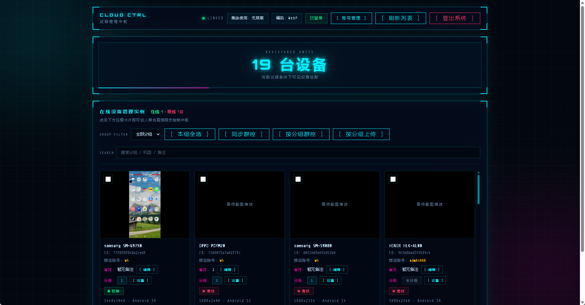
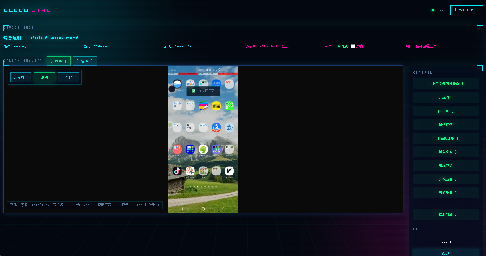
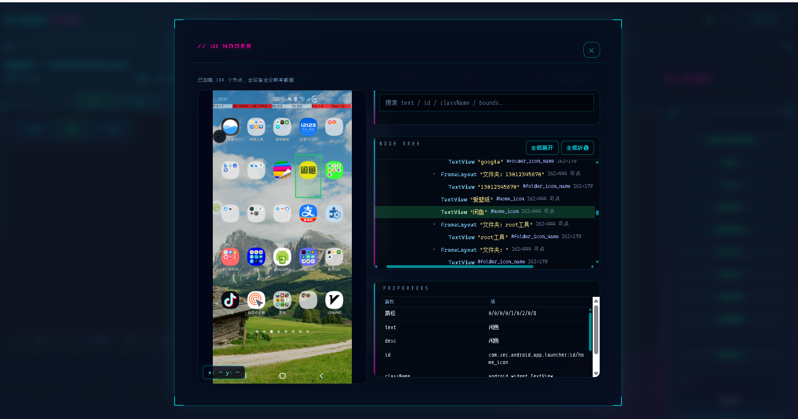
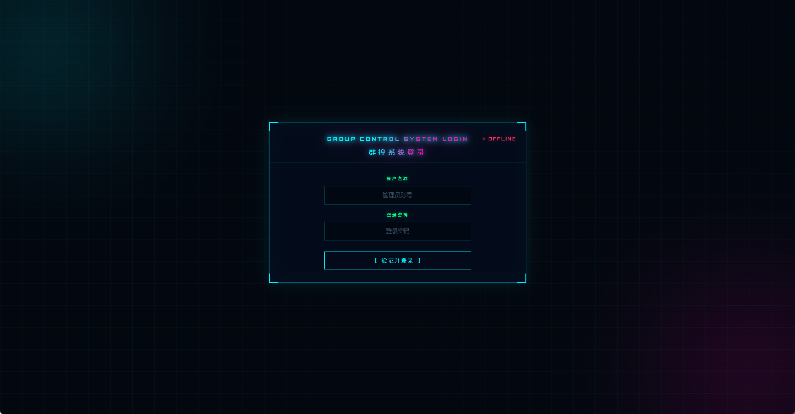
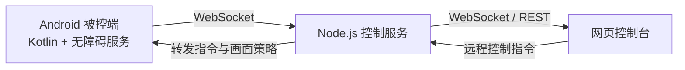


# Android Cloud Control Web

<div align="center">

一套轻量、高效的 Android 云设备管理与远程控制解决方案。  
通过 Node.js 后台统一管理设备、实时查看屏幕，并执行远程操作与自动化流程。

[功能特性](#-功能特性) · [界面预览](#-界面预览) · [快速开始](#-快速开始) · [技术架构](#-技术架构) · [项目文档](#-项目文档)

</div>

---

## 核心亮点

- ✅ **无需 Root，无需长期连接 ADB**
- ✅ **轻量被控端**：Kotlin 原生开发，当前版本约 3 MB
- ✅ **Node.js 后台统一管理**：设备、分组、用户与远程控制集中处理
- ✅ **实时画面同步**：支持 Base64、WebP、H.264 编码切换
- ✅ **节点树实时查看**：网页端查看 Android UI 层级与控件信息
- ✅ **手机端在线热更新**：后台下发版本后可在设备端更新
- ✅ **赛博朋克控制台**：全新视觉风格与实时状态反馈
- ✅ **低占用、高稳定**：兼容 Android 8–15

## 功能特性

### 设备控制

- 远程点击、长按、滑动与文本输入
- 返回、桌面、最近任务等系统操作
- 实时屏幕镜像与画质档位切换
- UI 节点树查看及控件定位辅助
- 截图、文件上传与设备端文件下发

### 自动化与群控

- 自动化流程脚本执行
- 多设备分组与批量操作
- 多用户设备绑定与权限管理
- 设备备注、状态与历史信息维护
- WebSocket 实时通信与断线重连

### 开发与扩展

- 前后端模块分离，方便二次开发
- 支持 REST API 与 WebSocket 协议扩展
- 可接入多种画面编码与传输策略
- 独立保留后台优化、接口及协议文档

## 界面预览

<table>
  <tr>
    <td align="center"><strong>控制台概览</strong></td>
    <td align="center"><strong>设备控制</strong></td>
  </tr>
  <tr>
    <td></td>
    <td></td>
  </tr>
  <tr>
    <td align="center"><strong>节点查看</strong></td>
    <td align="center"><strong>界面预览</strong></td>
  </tr>
  <tr>
    <td></td>
    <td></td>
  </tr>
</table>

## 技术架构



| 模块 | 技术栈 | 说明 |
|---|---|---|
| Android 被控端 | Kotlin、无障碍服务、MediaProjection、MediaCodec | 屏幕采集、编码、设备控制与热更新 |
| Node.js 服务端 | Node.js、Express、WebSocket | 实时通信、设备管理、画面转发与 API |
| Web 控制台 | HTML、CSS、JavaScript | 设备管理、远程控制、节点树与画面查看 |

## 快速开始

### 1. 启动后台

```bash
cd server
npm install
npm start
```

默认控制台地址：

```text
http://localhost:3000
```

如需 H.264 或生产环境部署，请参考 [HTTPS 与公网部署说明](./server/docs/DEPLOYMENT_HTTPS.md)。

### 2. 安装 Android 被控端

1. 使用 Android Studio 打开 `AndroidAccessibilityExample`
2. 配置后台服务器地址、端口和设备 Token
3. 构建或安装 APK
4. 在设备上授予无障碍、悬浮窗及录屏权限
5. 启动设备端并等待后台显示在线状态

详细配置请查看：

- [Android 被控端说明](./AndroidAccessibilityExample/README.md)
- [后台服务说明](./server/README.md)

### 3. 连接控制台

使用配置的管理员账号登录后台，在设备列表中选择目标设备，即可查看画面、执行控制或进行分组管理。

## 项目结构

```text
AndroidCloudControlWeb/
├── AndroidAccessibilityExample/   # Android Kotlin 被控端
├── server/                        # Node.js 后台与网页控制台
├── img.png                        # 控制台界面截图
├── img2.png                       # 设备控制截图
├── img3.png                       # 节点查看截图
└── img4.png                       # 界面预览截图
```

## 项目文档

| 文档 | 内容 |
|---|---|
| [Android 被控端 README](./AndroidAccessibilityExample/README.md) | Android 端配置、权限与功能说明 |
| [Android 技术架构](./AndroidAccessibilityExample/TECHNICAL_ARCH.md) | 被控端协议、模块与数据流 |
| [后台服务 README](./server/README.md) | API、WebSocket、部署与后台配置 |
| [集成指南](./server/INTEGRATION_GUIDE.md) | 可选模块接入方式 |
| [快速参考](./server/QUICK_REFERENCE.md) | 常用接口与协议速查 |
| [HTTPS 部署说明](./server/docs/DEPLOYMENT_HTTPS.md) | HTTPS、证书与公网访问配置 |

## 安全与使用说明

- 首次部署请立即修改默认管理员账号、Token 和 JWT 密钥
- 生产环境建议启用 HTTPS，并限制后台与 WebSocket 的访问来源
- 请仅在授权设备上使用远程控制与自动化功能
- 本项目涉及设备远程访问能力，请遵守所在地法律法规与使用政策

---

<div align="center">

Android Cloud Control Web · 让设备管理更轻量、更直观、更高效

</div>