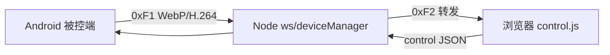

# Cloud Control Web 后台

Node.js 群控中转与管理服务：设备 WebSocket 接入、实时画面转发、远程控制、用户与设备归属、文件下发。

**被控端文档**：[AndroidAccessibilityExample/README.md](../../Android/AndroidAccessibilityExample/README.md)  
**HTTPS / Tunnel 部署**：[docs/DEPLOYMENT_HTTPS.md](docs/DEPLOYMENT_HTTPS.md)  
**优化与待办**：[OPTIMIZATION.md](OPTIMIZATION.md)

---

## 快速启动

```bash
npm install
npm start
```

| 访问方式 | 地址 | 说明 |
|----------|------|------|
| HTTP | `http://localhost:3000` | 列表、API；**无法** WebCodecs 解 H.264 |
| HTTPS | `https://localhost:3443` | 需 `certs/server.key` + `server.crt`（见 `scripts/gen-dev-cert.ps1`） |

环境变量（`.env` 或系统环境）：

```env
HOST=0.0.0.0
PORT=3000
HTTPS_PORT=3443
SSL_KEY_PATH=./certs/server.key
SSL_CERT_PATH=./certs/server.crt
ADMIN_USERNAME=admin
ADMIN_PASSWORD=password
ADMIN_TOKEN=admin-token
DEVICE_TOKEN=device-token
JWT_SECRET=secret-key
```

---

## 项目结构（当前）

```
server/
├── app.js                 # Express + HTTP/HTTPS 双监听
├── store.js               # 备注/分组 JSON 持久化
├── usersStore.js          # 用户、设备绑定、配额
├── routes/
│   ├── auth.js            # 登录 JWT
│   ├── devices.js         # 设备列表/备注/分组
│   ├── control.js         # REST 控制
│   ├── upload.js          # 文件上传下发
│   └── users.js           # 用户管理 API
├── ws/
│   ├── index.js           # WebSocket 入口、消息路由
│   ├── deviceManager.js   # 设备/观众/帧广播/上传策略（生产）
│   ├── frameProtocol.js   # 0xF1/0xF2 多格式帧（JPEG/WebP/H.264）
│   ├── thumbnailEncoder.js# 列表缩略图 sharp 压缩
│   ├── h264Processor.js     # H.264 NAL 分析（工具库）
│   ├── deviceManagerEnhanced.js  # 可选增强（未默认接入）
│   └── frameProtocol_v2.js       # 与 frameProtocol 重复，保留作参考
├── ai/elementLocator.js   # UI 文本定位（可选，未默认接入）
├── public/
│   ├── index.html / app.js      # 设备列表
│   ├── device.html
│   ├── control.js               # 控制页入口（ES module）
│   └── control/                 # state / codec / frame / session / viewer
│   ├── codec-client.js          # H.264 / WebP 能力协商
│   └── frame-decode-worker.js   # Web Worker 解码
├── data/                  # deviceRemarks.json, deviceGroups.json
└── docs/DEPLOYMENT_HTTPS.md
```

---

## 架构与数据流



- **画面上行**：设备二进制帧 → 解析 `frameProtocol` → 有控制观众时低延迟转发；列表缩略图走 `sharp` + JSON。
- **控制下行**：Web `control` → 设备 `control.command`；REST `/api/control` 为备用。
- **无人观看**：`pauseCapture` + `thumb` 档，省带宽与 CPU。

WebSocket 调优：`perMessageDeflate: false`、`setNoDelay(true)`、`maxPayload` 2MB。

---

## REST API 摘要

| 方法 | 路径 | 说明 |
|------|------|------|
| POST | `/api/auth/login` | 管理登录，返回 JWT |
| GET | `/api/devices` | 设备列表（需 `x-admin-token` 或 JWT） |
| GET | `/api/device/:id` | 设备详情 |
| GET | `/api/device/:id/frame` | 最新帧（JSON/Base64） |
| POST | `/api/device/:id/remark` | 备注 |
| POST | `/api/device/:id/group` | 分组 |
| POST | `/api/control` | 单设备控制 |
| POST | `/api/control/batch` | 批量控制 |
| POST | `/api/upload` | 文件下发（deviceId 或 group） |
| GET | `/api/health` | 健康检查 |
| GET/POST | `/api/speed-test-*` | 网速测试 |

用户与配额：`/api/users/*`（见 `users.html` 管理页）。

---

## WebSocket

### 设备端

```
ws(s)://<host>/ws?clientType=device&token=<DEVICE_TOKEN>&username=<用户>
```

注册、心跳、`ui_nodes`、`display_update`、二进制画面 — 详见上文被控端 [TECHNICAL_ARCH.md](../../Android/AndroidAccessibilityExample/TECHNICAL_ARCH.md)。

**在线判定**：45s 内有 `ping` 或帧活动视为在线。

**心跳响应 `pong`**：

```json
{ "type": "pong", "captureProfile": "thumb", "serverTs": 1730000000000 }
```

控制页打开时策略会提升为 `high` 并下发 `preferWebp` / `allowH264`（由 `control.js` + `deviceManager.applyDeviceUploadPolicy`）。

### 管理端（浏览器）

```
ws(s)://<host>/ws?clientType=web&token=<JWT或ADMIN_TOKEN>&deviceId=<可选>
```

常见下行：`device_list`、`device_registered`、`device_frame`（JSON 或二进制）、`device_ui_nodes`、`device_ping`。

---

## 二进制帧协议（已实现）

设备 → 服务端 `0xF1`：

```
[0xF1][format][idLen:2][deviceId][payload]
```

| format | 含义 |
|--------|------|
| 0x00 | JPEG |
| 0x01 | WebP |
| 0x02 | H.264 |
| 0x03 | H.264 + 时间戳等元数据 |

服务端 → 浏览器 `0xF2`：结构类似，由 `packWebFrame` 打包。

旧版无 `format` 字节时按 JPEG/WebP 魔数检测。

---

## 数据持久化

- `data/deviceRemarks.json`、`data/deviceGroups.json`
- `usersStore` 用户与设备绑定（JSON）
- `public/uploads/` 上传文件

无 MySQL；适合中小规模与单机部署。大规模需外接 DB 与 Redis 会话。

---

## 文档索引

| 文档 | 用途 |
|------|------|
| [QUICK_REFERENCE.md](QUICK_REFERENCE.md) | 协议与模块速查 |
| [BACKEND_SUPPORT_PLAN.md](BACKEND_SUPPORT_PLAN.md) | 历史方案 + 实现状态 |
| [INTEGRATION_GUIDE.md](INTEGRATION_GUIDE.md) | 可选模块接入步骤 |
| [OPTIMIZATION.md](OPTIMIZATION.md) | 后台优化路线图 |
| [docs/DEPLOYMENT_HTTPS.md](docs/DEPLOYMENT_HTTPS.md) | 生产 HTTPS / Tunnel |

---

## 适用场景

- 安卓群控、远程维护、批量文件下发
- 局域网调试 + 公网 Tunnel（`wss://`）

**注意**：默认 Token 仅适合开发；生产务必修改 `ADMIN_*`、`DEVICE_TOKEN`、`JWT_SECRET` 并启用 HTTPS。
